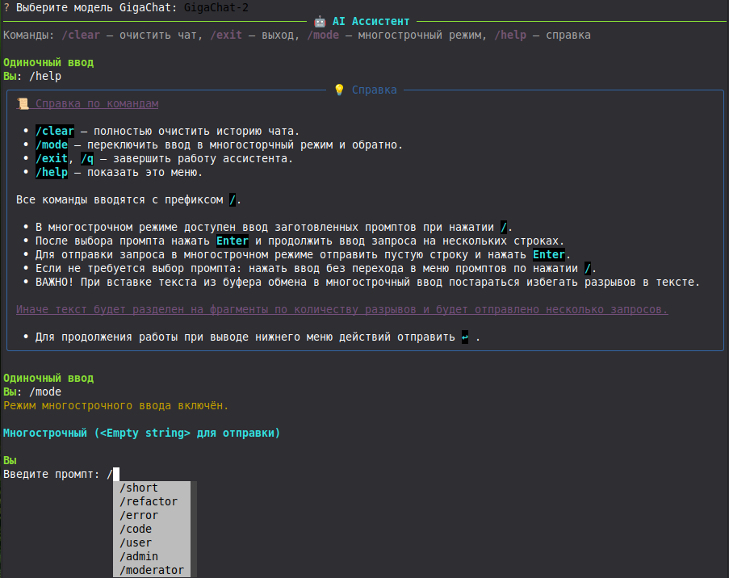

# GigaChat Console
Интерактивный консольный клиент для GigaChat с поддержкой многострочного ввода, заготовленных промптов и cсервисным меню.




## 🚀 Быстрый старт

1. **Клонируй репозиторий** или скачай файлы в удобную папку.
2. **Создай виртуальное окружение** (рекомендуется):
   ```bash
   python -m venv venv
   # Linux/macOS
   source venv/bin/activate
   # Windows (PowerShell)
   .\venv\Scripts\Activate.ps1
   ```
3. **Установи зависимости**:
   ```bash
   pip install -e .
   ```
   *(Это установит все нужные библиотеки из `pyproject.toml`)*.
4. **Настрой окружение** (см. раздел «Настройка»).
5. **Запусти клиент**:
   ```bash
   python run.py
   ```

> 💡 **Совет:** Для быстрого запуска можно добавить алиас в свой конфиг оболочки (`~/.bashrc` или `~/.zshrc`):
> ```bash
> alias gigachat='cd /путь/к/проекту && python run.py'
> ```
> После этого достаточно вводить в терминале: `gigachat`.

---

## 🔐 Настройка

### 1. Заполни `.env`
Создай файл `.env` в корне проекта и добавь туда следующие переменные:

```env
GIGA_CHAT_KEY=tokenfromgigachat
DOWNLOAD_DIR=/home/user/Downloads/
WORK_DIR=/home/user/work/
TOKENS_FILE=tokens.json
PROMPTS_FILE=prompts.json
```

- `GIGA_CHAT_KEY`: API‑ключ из кабинета GigaChat.
- `DOWNLOAD_DIR` / `WORK_DIR`: абсолютные пути к папкам (без `~`).
- `TOKENS_FILE` / `PROMPTS_FILE`: имена файлов (они должны лежать в корне проекта).

### 2. Настрой `tokens.json`
В этом файле указываются лимиты токенов для разных моделей. Получи актуальные лимиты в кабинете GigaChat и заполни файл по шаблону:

```json
{
    "GigaChat-2": 249881608,
    "GigaChat-2-Pro": 39969242,
    "GigaChat-2-Max": 24999064,
    "GigaChat-3-Ultra": 49996189
}
```

### 3. Настрой `prompts.json` (опционально)
Здесь хранятся готовые заготовки промптов. Ты можешь использовать их в чате через меню. Пример структуры:

```json
{
    "/short": "Отвечай кратко. Отвечай только на вопрос. Приводить примеры кода не надо",
    "/refactor": "Проверь код. Перепиши. Минимальные изменения. Не переименовывать переменные!",
    "/error": "Неправильно. В коде ошибки. Изменить код. Минимальные изменения.",
    "/code": "Ты - middle python разработчик. Напиши функцию. По возможности минимальные зависимости",
    "/user": "",
    "/admin": "",
    "/moderator": ""
}
```

---

## 💬 Команды в чате

Все команды вводятся с префиксом `/`.

| Команда | Действие |
| :--- | :--- |
| `/clear` | Полностью очистить историю текущего чата. |
| `/mode` | Переключить режим ввода: обычный ↔ многострочный. |
| `/exit` или `/q` | Завершить работу ассистента. |
| `/help` | Показать это меню со справкой. |

---

## 📝 Как работать с многострочным режимом

Этот режим нужен, чтобы отправлять длинные тексты, код или запросы с переносами строк.

### Как активировать
1. Введи команду `/mode`. Статус в интерфейсе изменится на «Многострочный режим».
2. Теперь при вводе символа `/` откроется меню выбора заготовленных промптов из `prompts.json`.

### Варианты использования

**Вариант А: С выбором промпта**
1. Нажми `/` → выбери нужный пункт стрелками → нажми `Enter`.
2. Текст промпта автоматически подставится. Допиши свой запрос на нескольких строках.
3. Чтобы отправить сообщение, оставь **пустую строку** и нажми `Enter`. Клиент отправит весь накопленный текст одним сообщением.

**Вариант Б: Без промпта (просто длинный текст)**
1. Просто печатай текст, используя `Enter` для переноса строк.
2. Для отправки также оставь **пустую строку** и нажми `Enter`.

### ⚠️ Важные предупреждения

- **Пустая строка = отправка.** Если ты случайно нажмёшь `Enter` на пустой строке, запрос уйдёт раньше времени.
- **Копирование из буфера обмена.** При вставке текста из буфера старайся избегать лишних разрывов строк внутри смысловых блоков.
    - ❌ *Плохо:* Текст разбит на 10 строк с лишними `\n`. Клиент может воспринять это как несколько отдельных запросов или некорректно собрать контекст.
    - ✅ *Хорошо:* Вставь текст, проверь, чтобы абзацы не были разорваны случайными пустыми строками, и только потом отправляй (пустая строка + Enter).

---

## 📂 Структура проекта

```text
.
├── run.py                # Точка входа (запуск клиента)
├── .env                  # Переменные окружения
├── tokens.json           # Лимиты токенов моделей
├── prompts.json          # Готовые промпты
├── config/               # Логика конфигурации
├── chat/                 # Интерфейс, история, логика чата
├── utils/                # Вспомогательные функции
└── README.md             # Этот файл
```

---

## ❓ Вопросы и проблемы

Если при запуске возникает ошибка `Failed to export data` или `No such file or directory`:
1. Проверь, что в `.env` указаны **абсолютные пути** (например, `/home/user/downloads`, а не `~/downloads`).
2. Убедись, что указанные папки существуют, либо дай клиенту права на их создание.

Если не работает выбор промптов — проверь, что файл `prompts.json` валиден (синтаксис JSON) и лежит в корне.
```
